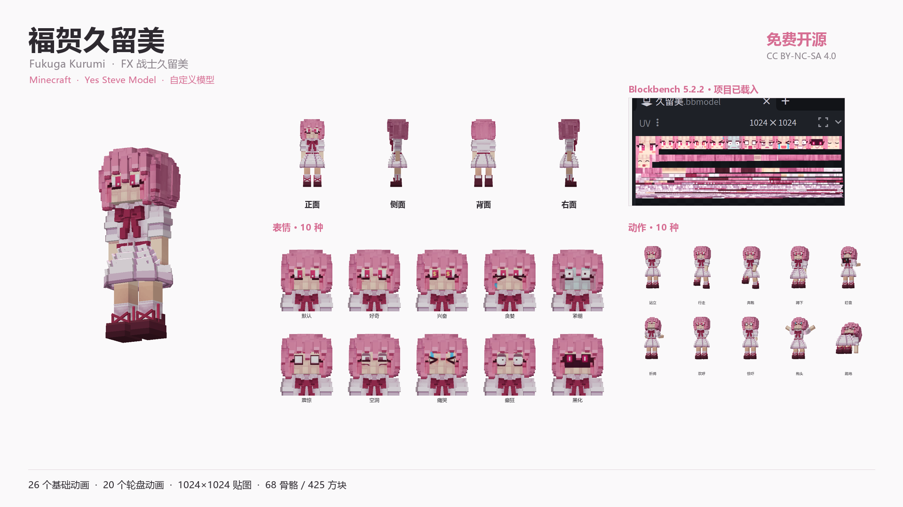
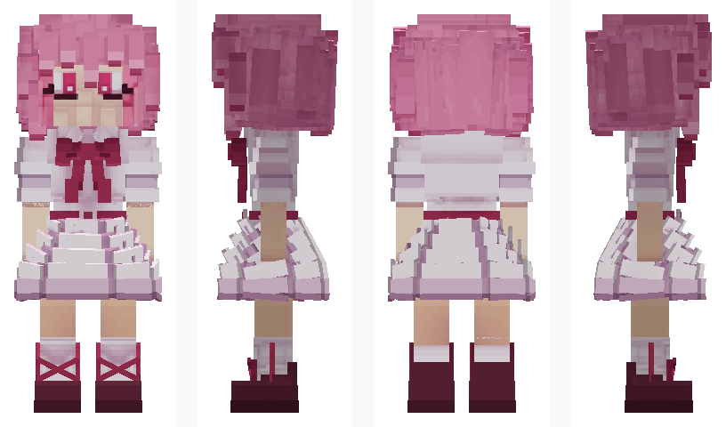
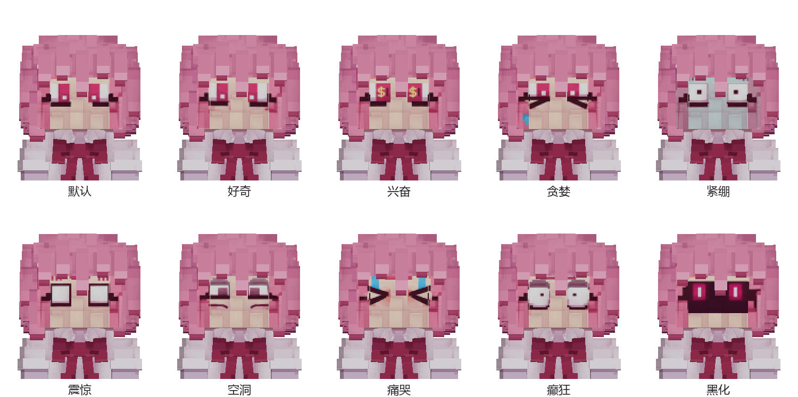
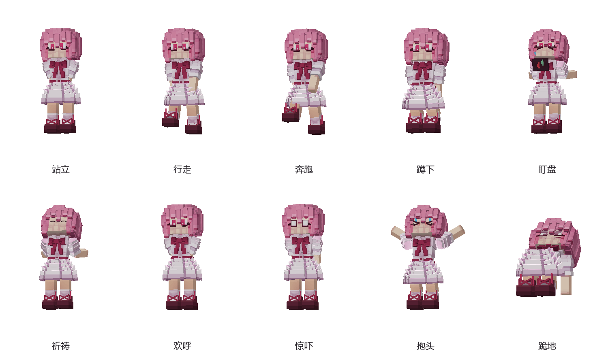

# 福贺久留美 · Minecraft 自定义模型

**Fukuga Kurumi — YSM (Yes Steve Model)**

粉色 Bob 短发 · 品红大眼 · 白色泡泡袖连衣裙 · 深红蝴蝶结

---

## 这是什么

《FX戦士くるみちゃん》中「福贺久留美」的 Minecraft 玩家模型，基于 **YSM（Yes Steve Model）** 制作。

不是普通的 64×64 皮肤，是**带骨骼、带表情、带动画的自定义模型**。

| 项目 | 数据 |
|---|---|
| 骨骼 | 68 |
| 方块 | 425 |
| 贴图 | 1024 × 1024 |
| 基础动画 | 26 个（idle / walk / run / sneak / jump / swim / sit / fly…） |
| 表情 | 10 种 |
| 动作 | 10 种 |

---

## 安装

### 1. 前置

- Minecraft **1.20.1**
- **Forge** 或 **Fabric**
- **Yes Steve Model 2.6.x**
  - [Modrinth 下载](https://modrinth.com/mod/yes-steve-model)
  - 注意区分 Forge / Fabric 版本

### 2. 放模型

把 §kurumi§ 文件夹放进：

§§§
.minecraft/config/yes_steve_model/custom/
§§§

> 服务器玩家需要服主安装，单机自己装即可。
> 如果用了启动器的「版本隔离」，路径是 §versions/<版本名>/config/yes_steve_model/custom/§

### 3. 加载

游戏内输入：

§§§
/ysm model reload
§§§

然后按 **Alt + Y**（Forge）或 **Y**（Fabric）打开模型选择界面，翻页找到「福贺久留美」。

---

## 使用

| 操作 | 按键 |
|---|---|
| 打开模型选择 | §Alt + Y§（Forge） / §Y§（Fabric） |
| 打开动画轮盘 | §Z§ |
| 重载模型 | §/ysm model reload§ |

轮盘里分两组：**表情 · 10 种** 和 **动作 · 10 种**。

命令方式（不用开轮盘）：

§§§
/ysm play @s expr_greedy    # 贪婪
/ysm play @s expr_manic     # 癫狂
/ysm play @s pose_kneel     # 爆仓跪地
/ysm play @s stop           # 停止
§§§

完整列表见 [docs/表情与动作.md](docs/表情与动作.md)。

---

## 预览

| 四视图 | 表情 |
|---|---|
|  |  |

| 动作 |
|---|
|  |

---

## 许可

**CC BY-NC-SA 4.0** — 可以自由使用、修改、二次分发，但必须：

- **署名**（BY）：注明原作者
- **非商业**（NC）：不能用于商业用途、付费整合包
- **相同方式共享**（SA）：修改后的作品必须使用同样的协议

详见 [LICENSE](LICENSE)。

### 同人声明

角色「福贺久留美」及《FX戦士くるみちゃん》的著作权归原作者 **でむにゃん / 炭酸だいすき** 及出版方所有。

本项目是**非商业同人二创**，仅授权本项目原创的模型、贴图、动画部分。
不代表获得原角色授权，不用于任何商业目的。

---

## 致谢

- 角色原作：でむにゃん・炭酸だいすき《FX戦士くるみちゃん》
- 模型格式：GeckoLib / Bedrock Geometry
- 模组：[Yes Steve Model](https://modrinth.com/mod/yes-steve-model)
- 工具：Blockbench
- 制作：AI 辅助（设定整理 / 建模 / 贴图 / 动画）
